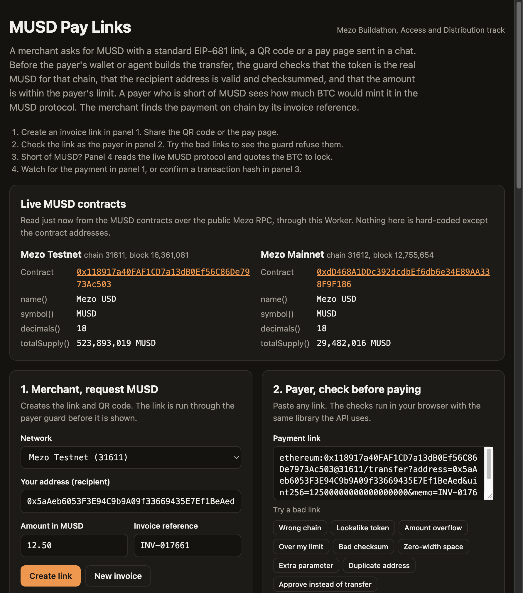

# MUSD Pay Links

Payment links, QR codes and invoices for MUSD on Mezo. A payer-side guard checks every link before a transfer is built. Built by [Michael Lip](https://github.com/theluckystrike) (Warsaw, Poland) for the Mezo Buildathon on AKINDO, Access and Distribution track.

- Live demo at https://musd-pay-links.lipmichal.workers.dev
- Pitch deck in [docs/pitch-deck.pdf](docs/pitch-deck.pdf)
- Raw evidence in [docs/evidence.json](docs/evidence.json)



## Results

Testnet only. No real money. Each row was checked on chain or on the live Worker.

| What | Proof | Result |
|---|---|---|
| Own borrow. `pnpm testnet-borrow` opens a trove | [`0x1de64d3a...26f2`](https://explorer.test.mezo.org/tx/0x1de64d3a9fe0588d2707718ed3c247d793f5d5f818efd502ae80ee8dc70a26f2) | 0.049 test BTC locked, 1,800 MUSD minted, block 16370809 |
| Own payment of invoice `INV-65ZVUMXW` | [`0x7abfedb1...cc0b`](https://explorer.test.mezo.org/tx/0x7abfedb120383f817134e5e63823aef69948930fa9760c6b96fb03a87909cc0b) | 5 MUSD with the reference in the transfer data, block 16370829 |
| Invoice found by its reference, no hash given | live `GET /api/invoices/INV-65ZVUMXW` | `paid` |
| Signed invoice `INV-P92MNPCN`, made by `pnpm create-invoice` with the merchant key | live `POST /api/invoices` | 201, `signed: true`. Unsigned create gives 401 |
| Payment of that invoice, then `POST .../confirm` | [`0x9b8285c1...825c`](https://explorer.test.mezo.org/tx/0x9b8285c19033cc957932406347234a8b339e85fc2c1848fb672f522dd10a825c) | `confirming` at 3 of 5 confirmations, then `paid` |
| Same payment with a wrong reference or a later invoice block | live `/api/verify` | `mismatch` |
| MUSD contracts on testnet and mainnet | `name()`, `symbol()`, `decimals()` | "Mezo USD", "MUSD", 18 |
| Borrow quote from the live MUSD protocol | PriceFeed, TroveManager, BorrowerOperations, InterestRateManager | price, MCR, CCR, fee, minimum debt |
| Tests | `LIVE=1 pnpm test` on 26 October 2026 | 337 of 337 passed |

The payer and the merchant are both test addresses of the project. The payments came from scripts. No browser wallet has paid a link yet.

## What it does

1. The merchant creates an invoice. The wallet that receives the payment signs it (EIP-191 `personal_sign`, a free message). The Worker gives the invoice a unique reference and stamps it with the current block.
2. The merchant shares an EIP-681 link, a QR code or a pay page. A pay page (`/?invoice=...`) is payer-only. It shows the amount, recipient, token, network, reference, status with confirmation depth, the QR code and the Pay action. The merchant panels stay hidden.
3. The payer's guard checks the link. The token must be the real MUSD contract for the chain id. The recipient must be a valid address. The amount must be within the payer's limit. Every refusal has a code and a plain reason. The guard returns an unsigned `transfer` call. It never holds a key.
4. A payer who is short of MUSD sees how much BTC would mint it in the MUSD protocol. The page links to the borrow page of the Mezo app.
5. The Worker finds the payment on chain by its reference. The payer does not send a hash.
6. A wallet may drop the reference. Such a payment shows as a possible match. The invoice recipient signs an accept request that names the reference and the transaction hash. The watch panel offers an **Accept this payment** button. It asks for the invoice recipient's wallet and signs a message. The invoice is then recorded as paid with `referenceMissing: true`.

## How it protects the money

- The pay page checks the chain when it opens and again right before the wallet window opens. Pay stays locked when a matching payment exists, when the search cannot cover every block since the invoice, or when the check fails. A second click while the wallet is open does nothing. The page remembers a hash it sent, so a reload or a second tab does not pay again.
- The page does not stop two different browsers. Two payers can still race, so both can pay the same open invoice before either payment is on chain. The invoice records the oldest payment. A later payment with the same reference is listed as a duplicate, with its transaction hash and a refund due.
- A smaller payment with the reference, or a payment of the exact amount without it, also locks Pay. The payer must say it is not theirs first.
- An invoice is recorded as paid only at 5 confirmations (`CONFIRMATIONS_REQUIRED`). Before that, the answer is `confirming` with the depth.
- `GET /api/verify` always returns `final`. It is `false` until the payment reaches 5 confirmations, and the pay page shows `Confirming` until `final` is `true`.
- `POST /api/invoices/:memo/confirm` with `{"tx":"0x..."}` records a payment by hash. It checks the stored invoice, not the caller. Use it for invoices older than the search window of about 23 hours.
- `POST /api/invoices/:memo/accept` with `{"tx":"0x...","timestamp":...,"signature":"0x..."}` records a payment that arrived without the reference. Only the invoice recipient can sign it. The signature covers the chain, recipient, reference, transaction hash and time. The payment must be the exact amount and at least 5 blocks deep. The stored payment has `referenceMissing: true`.
- One transaction pays one invoice. A payment mined before the invoice block does not count. The reference must match exactly.
- Reference claims and paid transaction hashes are compare-and-set in a Durable Object per chain, so concurrent creates cannot share a reference and one transaction cannot pay two invoices.
- Only the recipient wallet can create invoices for its address. The signature covers chain, recipient, amount, reference and time. The time must be within 10 minutes. A replay gets 409, because the reference is already used.
- A recipient address in one case (no EIP-55 checksum) is accepted with the warning `recipient_no_checksum`. A mixed-case address with a wrong checksum is refused.

The guard also refuses fake and lookalike tokens, the wrong chain, amounts above uint256, unicode tricks, percent-encoding, extra or duplicated parameters, and `approve` or other functions. The tests in `test/guard.test.ts` list every case.

## MUSD contracts

From the Mezo docs page "MUSD Payments With x402". Both are verified source on the Mezo explorers.

| Network | Chain id | MUSD contract |
|---|---|---|
| Mezo Testnet | 31611 | [`0x118917a40FAF1CD7a13dB0Ef56C86De7973Ac503`](https://explorer.test.mezo.org/token/0x118917a40FAF1CD7a13dB0Ef56C86De7973Ac503) |
| Mezo Mainnet | 31612 | [`0xdD468A1DDc392dcdbEf6db6e34E89AA338F9F186`](https://explorer.mezo.org/token/0xdD468A1DDc392dcdbEf6db6e34E89AA338F9F186) |

The MUSD protocol addresses come from the deployment files in https://github.com/mezo-org/musd and are in `src/chains.ts`.

## Link format

`ethereum:0x118917a40FAF1CD7a13dB0Ef56C86De7973Ac503@31611/transfer?address=0x5aAeb6053F3E94C9b9A09f33669435E7Ef1BeAed&uint256=12500000000000000000&memo=INV-1042`

The amount is in base units (12.5 MUSD here). The `memo` is up to 32 characters. The guard appends its bytes after the `transfer` arguments. The MUSD contract ignores them. `memo` is not part of EIP-681, so a wallet that does not know it may drop the reference. Such a payment shows as a possible match for a person to check.

## API

| Endpoint | Purpose |
|---|---|
| `GET /api/check?link=...&max=50` | Payer guard. 200 with the transaction, 422 with reasons. `&checksum=1` refuses addresses with no checksum |
| `GET /api/link?chain=31611&to=0x...&amount=12.5` | Link and QR code |
| `POST /api/invoices` | Signed create. Body has `chain`, `to`, `amount`, `memo`, `timestamp`, `signature`. 401 without a valid signature |
| `GET /api/invoices/INV-...?chain=31611` | Check one invoice on chain. `paid`, `confirming` or `open`. A paid answer lists later transfers with the same reference as `duplicates`, with `duplicatesChecked` |
| `POST /api/invoices/INV-.../confirm?chain=31611` | Confirm by hash with `{"tx":"0x..."}` |
| `POST /api/invoices/INV-.../accept?chain=31611` | Accept a no-reference payment. Body has `tx`, `timestamp`, `signature` by the invoice recipient |
| `GET /api/invoices?chain=31611&to=0x...` | The 20 newest invoices of an address |
| `GET /api/verify?chain=31611&tx=0x...&to=0x...&amount=5&memo=INV-1` | Check one payment. Always gives `final`, with `confirmations` and `required`. `final` is true only at 5 confirmations |
| `GET /api/payments?chain=31611&to=0x...` | Merchant inbox. `matches` and `possible` are `null` when not evaluated |
| `GET /api/borrow?chain=31611&need=25` | Borrow quote from the live MUSD protocol |

HTTP codes follow the answer. 200 for `paid`, `paid_no_memo`, `confirming`, `open` and `pending`. 401 for a bad signature. 404 for `not_found`. 409 for a used reference or transaction, and for a second payment of a paid invoice (`already_paid`). 422 for `mismatch`, `failed` and `not_possible` (a transaction for the other action, with or without the reference). 503 when the network does not answer. Errors never contain internal detail.

Chain routes send no CORS header. They allow 30 calls a minute per client. Writes allow 10 a minute. A Durable Object keeps the exact count.

## Setup

Node 22 or later and pnpm.

```sh
pnpm install
pnpm test            # no network
LIVE=1 pnpm test     # also reads the real contracts
pnpm typecheck
pnpm deploy          # Cloudflare Workers
```

Scripts that use a testnet key file. The key stays outside the repo and is never printed.

```sh
MEZO_KEY_FILE=/path/to/key pnpm testnet-borrow --dry-run
MEZO_KEY_FILE=/path/to/key pnpm testnet-pay "ethereum:..." 5
MEZO_KEY_FILE=/path/to/key pnpm create-invoice 5          # signed invoice for the key's address
```

## Known limits

- No browser wallet has paid a link yet. Wallet support for EIP-681 token links varies.
- References are unique per chain, first come first served. A random reference is the default.
- Signed create works with plain wallets (EOA). Smart-contract wallets (EIP-1271) are not supported yet.
- Invoices made before 26 October 2026 have no signature. They stay readable and show `signed: false`.
- After about 23 hours an open invoice cannot prove on its page that it is unpaid, so its Pay button stays locked. The merchant makes a new invoice or records a payment by hash.
- A payment without the reference is not recorded automatically. The page shows it as a possible match. The invoice recipient accepts it with a signed `POST .../accept` request for its transaction hash, so a person checks it first.
- Two payers can pay the same open invoice before either payment is mined. The invoice records the oldest payment. Every later transfer with the same reference is listed as a duplicate, with its transaction hash, and needs a refund.
- The app uses MUSD only. It does not use the MEZO token yet.
- The verifier trusts the public Mezo RPC endpoints.

## License

MIT. See [LICENSE](LICENSE).
